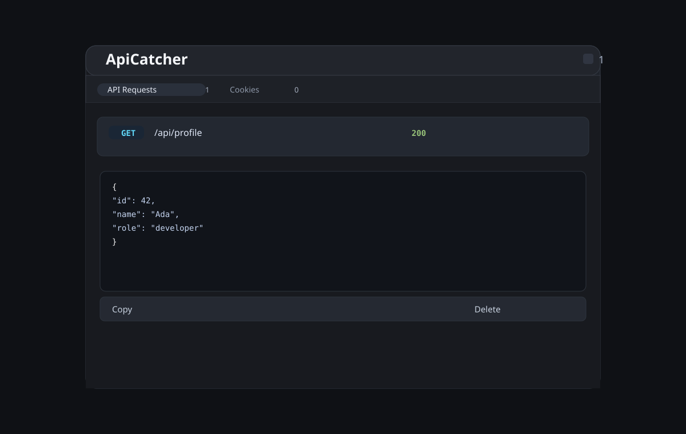
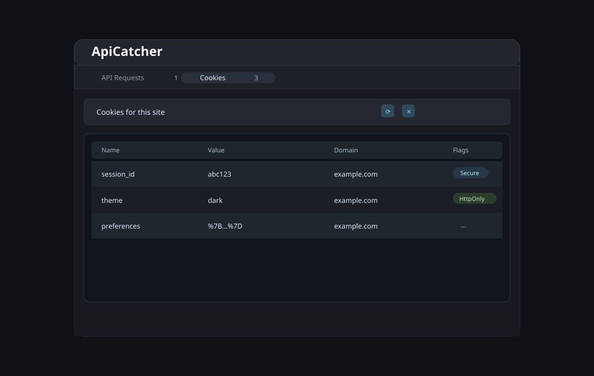

# ApiCatcher

ApiCatcher is a browser extension for inspecting JSON responses and cookies directly on the current page.

[](LICENSE)
[](https://github.com/M003aad/ApiCatcher/releases)
[](manifest.json)
[](https://github.com/M003aad/ApiCatcher/actions/workflows/ci.yml)

## Table of contents

- [Overview / Architecture](#overview--architecture)
- [Features](#features)
- [Screenshots](#screenshots)
- [Codebase breakdown](#codebase-breakdown)
- [Permissions](#permissions)
- [Installation & setup](#installation--setup)
- [Usage](#usage)
- [Messaging & API reference](#messaging--api-reference)
- [Scripts](#scripts)
- [Contributing](#contributing)
- [Security](#security)
- [License](#license)

## Overview / Architecture

ApiCatcher is a Manifest V3 browser extension designed to help developers inspect JSON payloads created by `fetch` and `XMLHttpRequest` requests while browsing a webpage. It uses a lightweight in-page UI to show network responses and cookies without leaving the page context.

The project is built with plain JavaScript and CSS, using browser extension APIs instead of a framework or bundler. The architecture is split across a background service worker and content scripts:

- `background.js`: handles toolbar clicks, badge updates, cookie reads/removals, and message routing.
- `interceptor.js`: runs at `document_start` in the main world to intercept network calls and forward JSON responses.
- `content.js`: mounts the floating inspection panel, renders API and cookie data, and forwards UI actions back to the background worker.
- `content.css`: styles the floating inspector panel.
- `manifest.json`: declares the extension metadata, permissions, and content-script injection rules.

This extension targets Chromium-based browsers that support Manifest V3, with the current manifest configured for Chrome/Edge-style extension loading in Developer Mode.

## Features

- Toggle the panel from the extension toolbar.
- Capture JSON responses from `fetch` calls.
- Capture JSON responses from `XMLHttpRequest` calls.
- Display request method, URL, HTTP status, and formatted JSON data.
- Expand and collapse each request result for deeper inspection.
- Copy all captured responses or a single response.
- Clear all captured responses or delete individual entries.
- Refresh the request list without reloading the page.
- Inspect cookies currently available for the active site.
- Show cookie name, value, domain, and security flags.
- Copy all cookies or a single cookie row.
- Delete individual cookies or clear all cookies for the current domain.
- Refresh the cookie list after site changes.
- Update the extension badge with API and cookie counts.
- Minimize, restore, and hide the in-page panel.
- Use icon buttons with accessible labels and tooltips.

## Screenshots

The extension UI is a floating panel with two tabs: API Requests and Cookies. The mockups below show the expected layout and styling used in the current extension implementation.

<div align="center">
  
  <p><em>API Requests tab mockup</em></p>
  
  <p><em>Cookies tab mockup</em></p>
</div>

## Codebase breakdown

```text
ApiCatcher/
├── .github/
│   ├── ISSUE_TEMPLATE/
│   │   ├── bug_report.md
│   │   └── feature_request.md
│   ├── PULL_REQUEST_TEMPLATE.md
│   └── workflows/
│       ├── ci.yml
│       └── release.yml
├── .editorconfig
├── .gitattributes
├── .gitignore
├── .prettierrc
├── CHANGELOG.md
├── CITATION.cff
├── CODE_OF_CONDUCT.md
├── CONTRIBUTING.md
├── SECURITY.md
├── SUPPORT.md
├── LICENSE
├── README.md
├── SUMMARY.md
├── background.js
├── content.css
├── content.js
├── eslint.config.js
├── icons/
│   ├── 16.16.png
│   ├── 32.32.png
│   ├── 48.48.png
│   └── 128.png
├── interceptor.js
├── manifest.json
├── package.json
└── Prompt.txt
```

| File / folder | Purpose |
| --- | --- |
| `.github/` | GitHub issue templates, pull request template, and CI/release automation. |
| `background.js` | Background service worker that handles action clicks, badge counts, and cookie operations. |
| `content.js` | Creates and manages the in-page inspector panel and its interactions. |
| `content.css` | Styles the inspector panel and its controls. |
| `interceptor.js` | Intercepts JSON responses from `fetch` and XHR and posts them to the page context. |
| `icons/` | Extension icon assets for the toolbar and manifest metadata. |
| `manifest.json` | Declares the extension name, version, permissions, content scripts, and action. |
| `package.json` | Defines the project scripts and development dependencies used for linting and validation. |
| `LICENSE` | AGPL-3.0 license file retained from the repository. |
| `README.md` | Project overview and developer documentation. |
| `Prompt.txt` | User-supplied task prompt and is not part of the runtime extension. |

## Permissions

The manifest declares the following extension permissions and host access:

| Permission | Required for | Reason |
| --- | --- | --- |
| `activeTab` | Toolbar-driven page interaction | Lets the extension operate on the currently active tab when the user clicks the extension action. |
| `scripting` | Script injection and page access | Enables the extension to run scripts on the current tab when needed. |
| `cookies` | Reading and deleting cookies | Supports cookie inspection and domain-wide cookie clearing. |
| `storage` | Future extension state management | Declared for extension storage compatibility and panel state persistence patterns. |
| `<all_urls>` | Host permission | Allows the content scripts and interceptor to run across the current page and access cookie data for the active site. |

## Installation & setup

1. Clone this repository locally.
2. Open a terminal in the project root.
3. Install the JavaScript tooling dependencies:

```bash
npm install
```

4. Open Google Chrome or Microsoft Edge.
5. Navigate to `chrome://extensions/` or `edge://extensions/`.
6. Enable **Developer mode**.
7. Click **Load unpacked**.
8. Select the repository folder to load the extension.
9. Open a normal `http://` or `https://` page and click the ApiCatcher icon in the toolbar.

No environment variables are required for this project, so there is no `.env` setup step.

## Usage

After loading the extension, use the toolbar button to toggle the in-page inspector. The panel shows two tabs:

- **API Requests**: shows captured JSON responses from page requests.
- **Cookies**: shows cookies for the current site and includes delete and clear actions.

Use the controls inside each tab to copy, refresh, delete, or clear data. The extension keeps the captures for the current page session and resets when the page refreshes.

## Messaging & API reference

ApiCatcher uses browser extension messaging between the background service worker and the page-level content script.

| Message / route | Direction | Payload | Response |
| --- | --- | --- | --- |
| `APICATCHER_TOGGLE` | `background.js` → `content.js` via `chrome.tabs.sendMessage` | `{ type: "APICATCHER_TOGGLE" }` | No direct payload; toggles the visible panel. |
| `APICATCHER_RESPONSE` | `interceptor.js` → `content.js` via `window.postMessage` | `{ source: "ApiCatcher", type: "APICATCHER_RESPONSE", payload: { url, method, status, data } }` | Content script stores the request payload in the panel state. |
| `updateBadge` | `content.js` → `background.js` via `chrome.runtime.sendMessage` | `{ action: "updateBadge", apiCount, cookieCount }` | `{ ok: true }` |
| `getCookies` | `content.js` → `background.js` via `chrome.runtime.sendMessage` | `{ action: "getCookies", url }` | `{ ok: true, cookies }` |
| `deleteCookie` | `content.js` → `background.js` via `chrome.runtime.sendMessage` | `{ action: "deleteCookie", cookie }` | `{ ok: true }` or error object |
| `clearCookies` | `content.js` → `background.js` via `chrome.runtime.sendMessage` | `{ action: "clearCookies", url }` | `{ ok: true }` or error object |

Example request payload captured from the page:

```json
{
  "url": "https://example.com/api/data",
  "method": "GET",
  "status": 200,
  "data": {
    "success": true,
    "items": [
      { "id": 1, "name": "example" }
    ]
  }
}
```

## Scripts

The project defines the following scripts in `package.json`:

| Script | Command | Purpose |
| --- | --- | --- |
| `lint` | `eslint . --max-warnings 0` | Runs the JavaScript linter with no warnings allowed. |
| `format` | `prettier --check .` | Verifies the repository formatting. |
| `validate` | `node -e ... && node --check ...` | Validates `manifest.json` and checks the extension JavaScript files for syntax errors. |
| `build` | `node -e ...` | Copies the extension files into a `dist/` bundle for local packaging. |

## Contributing

Contributions are welcome. See [CONTRIBUTING.md](./CONTRIBUTING.md) for bug-reporting guidance, local setup instructions, and pull request standards.

## Security

Please report security concerns through the process outlined in [SECURITY.md](./SECURITY.md). Do not disclose vulnerabilities publicly until the issue has been assessed and a fix is available.

## License

ApiCatcher is distributed under the [GNU Affero General Public License v3.0](LICENSE). Copyright © 2026 M003aad.
